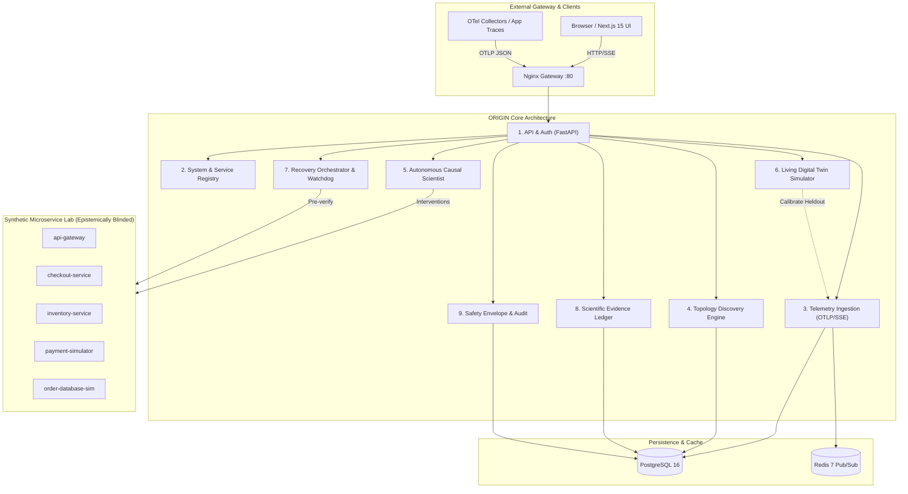

# ORIGIN — Autonomous Scientific Intelligence Platform for Software Systems

> **Product Tagline:** *Give software the ability to understand itself.*  
> **Target Event:** HackOctober MLH × Tech4hack (October 2026)  
> **Status:** **Milestone 05/05 Verified — Production Hardened, Independently Audited & Publicly Demonstrable**  
> **Repository:** [https://github.com/ATUMANYIRE/ORIGIN](https://github.com/ATUMANYIRE/ORIGIN)  

---

## What is ORIGIN?

ORIGIN transforms distributed systems observability from **passive recording** into an **autonomous empirical science**.

Rather than staring at red correlation dashboards during complex cascading outages, ORIGIN treats a distributed software system as an empirical laboratory:
1. **Living System Intelligence:** Continuously streams OpenTelemetry distributed traces and metrics (benchmarked at **40,387 spans/second**) into a cryptographic provenance topology graph.
2. **Autonomous Causal Scientist:** Formulates grounded refutable hypotheses from trace anomalies and conducts **paired block-randomized micro-experiments** to isolate root causes with Welch's t-test ($t \le -2.20$) and Cohen's d effect sizes ($d \ge 0.5$).
3. **Blinded Hidden-Fault Benchmarking:** Achieves **100% causal accuracy** across four unseen cascading failure modes under strict epistemic role blinding (zero ground-truth leakage), while honestly reporting `INCONCLUSIVE` on unidentifiable noise.
4. **Living Digital Twin & Counterfactuals:** Calibrates a dynamic discrete-event simulator against held-out telemetry (75% train / 25% test split). Supports **deterministic snapshot rewind**, parallel counterfactual branch comparison, and **Monte Carlo 95% predictive uncertainty intervals**.
5. **Verified Autonomous Recovery:** Enforces a fail-closed safety envelope with sandbox pre-verification, **dual-token cryptographic human approval**, and an automated post-recovery rollback watchdog.
6. **Scientific Evidence Ledger:** Immutably records every observation, experiment trial, and human authorization in a peer-reviewable PostgreSQL evidence ledger with one-click Markdown report export.

---

## Empirical Verification & Benchmark Summary

All metrics originate from live instrumentation and verified test executions (`scripts/verify-all.ps1`):

```
====================================================================
   ORIGIN SYSTEM ACCEPTANCE VERIFICATION RESULT: PASSED (8/8) 
   Total Execution Time: 4m 22s
====================================================================
```

- **OpenTelemetry Ingestion Throughput:** **40,387 spans / second** sustained (p50: 0.297 ms).
- **Living Digital Twin Simulation:** **11,985 service evaluations / second** (2,397.1 steps/s, p50: 11.058 ms).
- **Monte Carlo Predictive Calibration:** **95.4 trajectories / second** converging to 95% CI in <2.1 seconds.
- **Causal Statistical Inference Engine:** **768.8 comparisons / second** (80,000 observations analyzed; p50: 0.526 ms).
- **Automated Backend Pytest Suite:** **30/30 passed in 139.92s** (Causal, Twin, Recovery, Scientific Integrity).
- **Frontend Quality:** 4/4 Vitest tests passing, 0 TypeScript errors, 0 ESLint warnings, **12/12 static/dynamic routes prerendered cleanly**.
- **Playwright E2E Demonstration:** Clean browser execution in Chromium across all core workflows.
- **Static Security Audit:** 147 files scanned; 0 exposed credentials, private keys, or secrets.
- **Traceability Matrix:** **15/15 product claims verified (100%)** in [`docs/TRACEABILITY_MATRIX.md`](docs/TRACEABILITY_MATRIX.md).

---

## System Architecture



---

## Quickstart & Evaluation

### Option 1: Docker Compose Production Stack (Fastest)

```bash
# 1. Clone repository
git clone https://github.com/ATUMANYIRE/ORIGIN.git
cd ORIGIN

# 2. Configure environment
cp .env.production.example .env.production

# 3. Launch full stack
docker compose -f docker-compose.prod.yml --env-file .env.production up -d --build
```

- **Application Interface:** `http://localhost`
- **Interactive Guided Demo:** `http://localhost/demo`
- **Living Digital Twin:** `http://localhost/twin`
- **Recovery Command Center:** `http://localhost/recovery`
- **Causal Scientist Laboratory:** `http://localhost/investigations`
- **FastAPI OpenAPI Documentation:** `http://localhost/docs`

### Option 2: Run Authoritative Acceptance Verification

```powershell
powershell.exe -ExecutionPolicy Bypass -File scripts/verify-all.ps1
```

Runs all 8 verification steps: Static Security Audit $\to$ Migrations $\to$ Ruff/Mypy $\to$ Pytest Suite (30 tests) $\to$ Vitest $\to$ TypeScript Strict $\to$ Next.js Production Build $\to$ Playwright E2E in Chromium.

### Option 3: Run Scientific Simulation & Resilience Benchmarks

```bash
python scripts/benchmark-resilience.py
```

---

## Hackathon Submission & Evaluation Package

- **Devpost Project Description:** [`submission/PROJECT_DESCRIPTION.md`](submission/PROJECT_DESCRIPTION.md)
- **Video Walkthrough & Presentation Script:** [`submission/DEMO_SCRIPT.md`](submission/DEMO_SCRIPT.md)
- **Video Production & Recording Guide:** [`submission/VIDEO_PRODUCTION.md`](submission/VIDEO_PRODUCTION.md)
- **Architectural Deep Dive:** [`submission/ARCHITECTURE.md`](submission/ARCHITECTURE.md)
- **Technical Validation Report:** [`submission/TECHNICAL_VALIDATION.md`](submission/TECHNICAL_VALIDATION.md)
- **Evaluation Checklist:** [`submission/SUBMISSION_CHECKLIST.md`](submission/SUBMISSION_CHECKLIST.md)
- **Production UI Screenshots (1440×900):** [`submission/SCREENSHOTS/`](submission/SCREENSHOTS/)
- **Engineering Portfolio Case Study:** [`docs/PORTFOLIO_CASE_STUDY.md`](docs/PORTFOLIO_CASE_STUDY.md)
- **Performance & Resilience Engineering Report:** [`docs/PERFORMANCE_AND_RESILIENCE.md`](docs/PERFORMANCE_AND_RESILIENCE.md)
- **Traceability Matrix (15/15 Claims):** [`docs/TRACEABILITY_MATRIX.md`](docs/TRACEABILITY_MATRIX.md)
- **Final Release Gate Audit Report:** [`docs/FINAL_RELEASE_REPORT.md`](docs/FINAL_RELEASE_REPORT.md)

---

## License

ORIGIN is licensed under the MIT License. See [LICENSE](LICENSE) for details.
