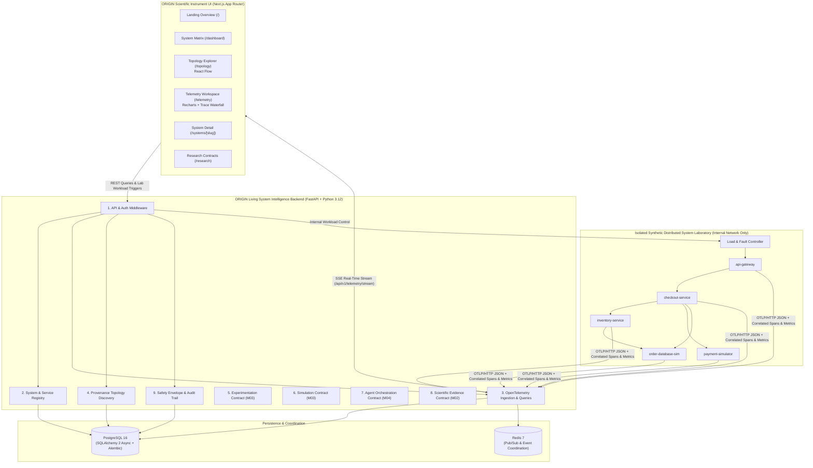

# ORIGIN — System Architecture (`01/05`)

## 1. High-Level Architecture

## 2. The Nine Architectural Boundaries

| Boundary | Package Path | Milestone 01/05 Status | Responsibility |
| :--- | :--- | :--- | :--- |
| **1. API & Auth** | `backend/app/modules/auth/`, `backend/app/api/` | **Implemented** | `X-Origin-Key` / Bearer token verification, `X-Correlation-ID` propagation, REST/OTLP/SSE routing. |
| **2. System Registry** | `backend/app/modules/registry/` | **Implemented** | Registration of systems, services, tiers, and declared dependencies. |
| **3. Telemetry Ingestion** | `backend/app/modules/telemetry/` | **Implemented** | OpenTelemetry OTLP/HTTP JSON (`traces` & `metrics`) and native batch ingestion, time-series statistical queries (`mean`, `p95`, `min`, `max`), SSE broadcast. |
| **4. Topology Discovery** | `backend/app/modules/topology/` | **Implemented** | Synthesizes directed service graphs combining declared dependencies with observed parent→child span calls, enforcing strict provenance. |
| **5. Experimentation** | `backend/app/modules/experimentation/` | **Contract & Schema Only** | `ExperimentProposalContract`, `ExperimentEngineProtocol`, and DB tables (`experiment_definitions`, `experiment_runs`) for Milestone 03/05. |
| **6. Simulation** | `backend/app/modules/simulation/` | **Contract Only** | `SimulationScenarioContract` and `SimulationEngineProtocol` for Milestone 03/05 counterfactual evaluation. |
| **7. Agent Orchestration** | `backend/app/modules/agents/` | **Contract Only** | `ScientificInvestigationTaskContract` and `AgentOrchestratorProtocol` for Milestone 04/05 multi-agent reasoning. |
| **8. Scientific Evidence** | `backend/app/modules/evidence/` | **Contract & Schema Only** | `HypothesisSubmissionContract`, `ScientificEvidenceLedgerProtocol`, and DB tables (`hypotheses`, `evidence_records`) for Milestone 02/05. |
| **9. Safety & Audit** | `backend/app/modules/safety/` | **Implemented Audit + Safety Contract** | Active `AuditService` persisting `audit_events` for all state mutations + `SafetyEnvelopeContract` for future experiments. |
