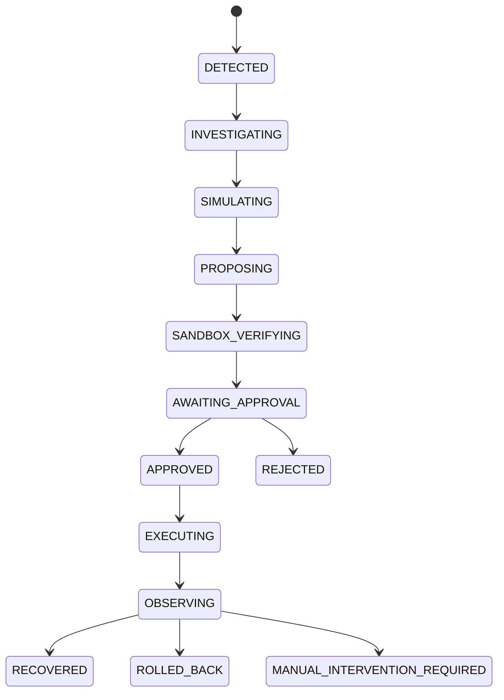

# ORIGIN Autonomous Recovery Intelligence Engine (`docs/RECOVERY_ENGINE.md`)

**Milestone:** `04/05 — Verified Autonomous Recovery, Agent Orchestration & Operational Safety`  
**Module:** [`backend/app/modules/recovery/service.py`](file:///E:/Projects/ORIGIN/backend/app/modules/recovery/service.py)

---

## 1. Recovery Lifecycle State Machine

ORIGIN enforces an explicit, persisted state machine (`VALID_RECOVERY_TRANSITIONS`) for every recovery workflow:

Every transition is persisted inside `recovery_plans.lifecycle_history_json` with:
- `from_state` and `to_state`
- `timestamp` (UTC ISO-8601)
- `actor` and `agent_role` (`Observer`, `Investigator`, `Simulator`, `RecoveryPlanner`, `Verifier`, `SafetyGovernor`, `ExecutionController`, `EvidenceAuditor`)
- `rationale`
- `evidence_refs` (trace/correlation/evidence IDs)

---

## 2. Strict Epistemic Separation: Simulated vs. Sandbox-Verified

Remediation candidates generated by the `RecoveryPlanner` and evaluated in the `DigitalTwinService` are explicitly initialized with:
- `verification_status = "simulated_only"`
- `simulation_prediction_json.epistemic_label = "counterfactual_prediction"`

A candidate is **never** marked `sandbox_verified` or eligible for human approval (`POST /api/v1/recovery/plans/{plan_id}/approve`) until an actual isolated laboratory sandbox trial (`POST /api/v1/recovery/plans/{plan_id}/sandbox-verify`) has:
1. Captured the initial laboratory configuration snapshot (`capture_lab_configuration()`).
2. Executed control-arm baseline transactions and recorded real latency/error measurements.
3. Applied the candidate remediation (`apply_lab_remediation_action()`).
4. Executed treatment-arm transactions and computed Welch's $t$-test, 95% confidence interval, and Cohen's $d$.
5. Checked for directional or magnitude disagreement between the Digital Twin prediction and measured sandbox results (`simulation_disagreement_json`).
6. Restored the laboratory to its exact initial configuration (`restore_lab_configuration()`) and verified restoration (`restoration_verified = True`).

---

## 3. Resumability, Idempotency & Interruption Safety

- **Idempotency Keys**: Both workflow creation (`POST /api/v1/recovery/plans`) and approved execution (`POST /api/v1/recovery/plans/{plan_id}/execute`) accept an optional `idempotency_key` (`recovery_plans.idempotency_key`, `recovery_executions.idempotency_key`). Retrying a request with the same key returns the existing persisted workflow/execution without re-applying mutations.
- **Step-by-Step Resumability**: Every stage (`create_recovery_workflow`, `generate_and_simulate_candidates`, `run_sandbox_verification`, `submit_human_approval`, `execute_approved_recovery`) commits its state to PostgreSQL so interrupted workflows can resume from their exact persisted state.
