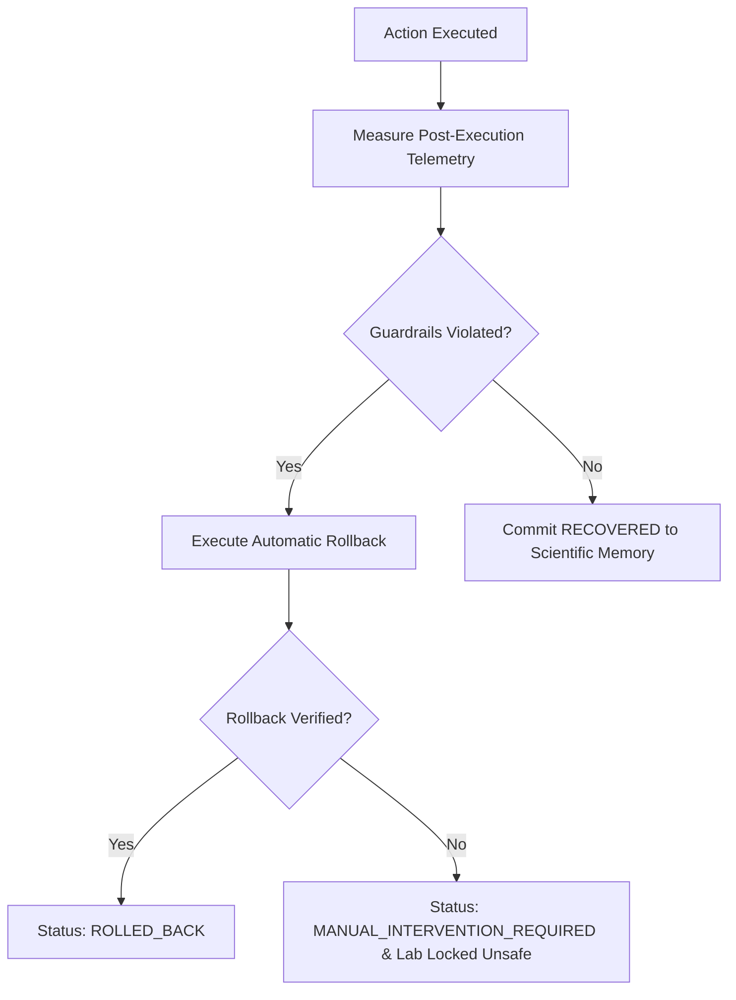

# ORIGIN Saga Rollback, Failure Recovery & Manual Intervention Protocol (`docs/ROLLBACK_AND_FAILURE_RECOVERY.md`)

**Milestone:** `04/05 — Verified Autonomous Recovery, Agent Orchestration & Operational Safety`  
**Endpoints:** `POST /api/v1/recovery/plans/{plan_id}/rollback`, `POST /api/v1/recovery/plans/{plan_id}/cancel`  
**Module:** [`backend/app/modules/recovery/service.py`](file:///E:/Projects/ORIGIN/backend/app/modules/recovery/service.py)

---

## 1. Automatic Post-Execution Guardrails & Auto-Rollback

During the `OBSERVING` phase of execution, ORIGIN runs real instrumented transactions through the Synthetic Laboratory and measures latency and error rate against operational guardrails:



Auto-rollback is triggered immediately if:
- Latency fails recovery target against baseline ($> \text{baseline} \times 0.78$ and $> 260.0$ ms).
- Error rate exceeds guardrail ($> 8.0\%$).
- Execution timeout expires.
- Operator requests cancellation during observation.

---

## 2. Operator Manual Rollback

Human operators can invoke an immediate manual rollback at any time:
```http
POST /api/v1/recovery/plans/{plan_id}/rollback
Content-Type: application/json
X-Origin-Key: origin-dev-scientific-key-2026

{
  "reason": "Operator observed secondary memory pressure anomaly."
}
```

---

## 3. Rollback Failure & `MANUAL_INTERVENTION_REQUIRED`

If a rollback execution fails to restore initial configuration or if residual mutation verification fails:
1. The execution status transitions to `MANUAL_INTERVENTION_REQUIRED`.
2. The synthetic laboratory is locked as unsafe (`mark_lab_unsafe()`), preventing any subsequent sandbox runs or workloads until manually unlocked via `POST /api/v1/safety/clear-lab-lock`.
3. An audit event of severity `critical` is appended to the audit ledger.
