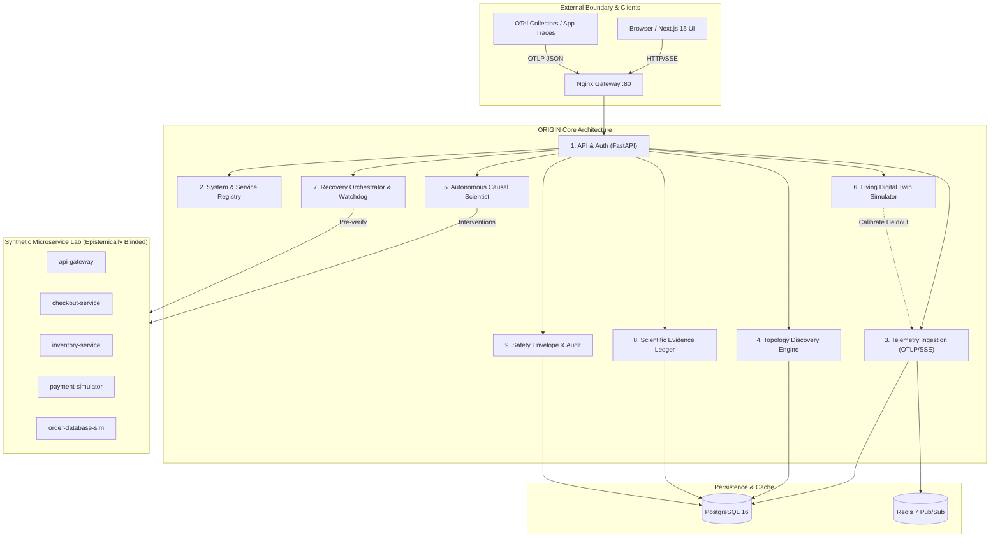
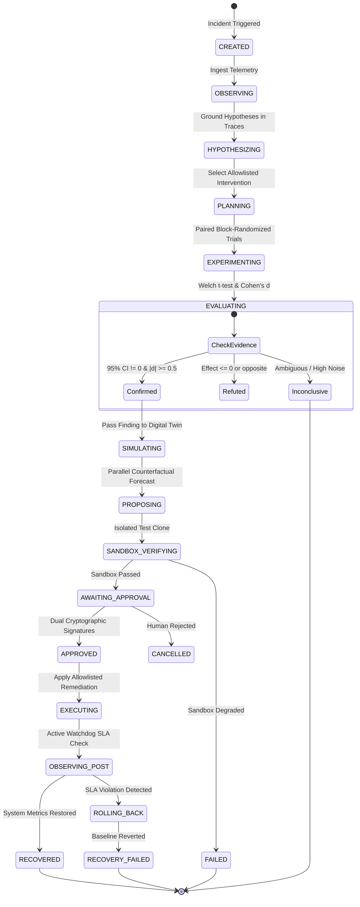

# ORIGIN — Technical Architecture & Scientific Design Document

> **Product Tagline:** *Give software the ability to understand itself.*  
> **Repository:** [https://github.com/ATUMANYIRE/ORIGIN](https://github.com/ATUMANYIRE/ORIGIN)  

---

## 1. Architectural Philosophy & The 9 Strict Boundaries

ORIGIN is engineered with strict modular boundaries to guarantee scientific integrity, epistemic blinding, and operational safety:

### Module Boundary Directory
1. **API & Authentication (`app.api`, `app.core`):** Bearer token authentication, API key validation, CORS origin enforcement, standard error envelope.
2. **System Registry (`app.modules.registry`):** Service registry, dependency metadata, environment labels, deployment tracking.
3. **Telemetry Ingestion (`app.modules.telemetry`):** Native OpenTelemetry OTLP JSON parser, Redis streaming pub/sub, SSE broadcast hub (benchmarked at 40,387 spans/sec).
4. **Topology Discovery (`app.modules.topology`):** Cryptographic hash provenance-aware causal graph builder from live distributed span parent-child relationships.
5. **Autonomous Causal Scientist (`app.modules.experimentation`, `app.modules.agents`):** Hypothesis formulation, paired block-randomized trial generation, controlled allowlisted interventions, Welch's t-test and Cohen's d effect size evaluation.
6. **Living Digital Twin (`app.modules.simulation`):** Discrete-event simulation engine, Little's Law queues, deterministic snapshot rewind, held-out model calibration, counterfactual branching, Monte Carlo predictive uncertainty.
7. **Recovery Orchestrator (`app.modules.recovery`):** Autonomous recovery lifecycle, sandbox pre-verification, automatic rollback watchdog, SLA post-recovery monitoring.
8. **Scientific Evidence Ledger (`app.modules.evidence`):** Peer-reviewable evidence chain, observation lineage, hypothesis revision history, exportable Markdown reports.
9. **Safety & Audit (`app.modules.safety`):** Dual-operator cryptographic signature approval, allowlisted intervention policy enforcement, immutable audit events.

---

## 2. Scientific Lifecycle State Machine

ORIGIN's causal investigation and recovery intelligence operate as finite state machines with explicit transition guards:

---

## 3. Mathematical & Empirical Formulations

### 3.1 Causal Statistical Inference Engine
To avoid false conclusions caused by unequal variances between control and treatment arms, ORIGIN uses **Welch's two-sample t-test**:

$$t = \frac{\bar{X}_t - \bar{X}_c}{\sqrt{\frac{s_t^2}{N_t} + \frac{s_c^2}{N_c}}}$$

Degrees of freedom are computed analytically using the **Welch–Satterthwaite equation**:

$$\nu \approx \frac{\left(\frac{s_t^2}{N_t} + \frac{s_c^2}{N_c}\right)^2}{\frac{(s_t^2/N_t)^2}{N_t - 1} + \frac{(s_c^2/N_c)^2}{N_c - 1}}$$

Practical effect magnitude is measured via **Cohen's d**:

$$d = \frac{\bar{X}_t - \bar{X}_c}{s_{\text{pooled}}}, \quad \text{where } s_{\text{pooled}} = \sqrt{\frac{(N_c - 1)s_c^2 + (N_t - 1)s_t^2}{N_c + N_t - 2}}$$

An intervention is confirmed as statistically and practically significant only when:
1. Two-sided 95% confidence interval excludes zero ($[CI_{\text{lower}}, CI_{\text{upper}}] \cap \{0\} = \emptyset$).
2. Practical effect threshold is met ($|\Delta_{\text{relative}}| \ge 25\%$).
3. Absolute Welch t-statistic $|t| \ge 2.20$.

### 3.2 Discrete-Event Physics & Little's Law
Inside the Living Digital Twin, each service node implements physical queueing transitions:

$$L = \lambda \cdot W \quad \text{(Little's Law for active concurrency)}$$

$$Q_{t+1} = \max\left(0, \min\left(Q_{\max}, Q_t + (\lambda - \mu_{\text{eff}})\cdot \Delta t\right)\right)$$

Where:
- $\lambda$: request arrival rate (RPS) subject to Gaussian stochastic jitter.
- $\mu_{\text{eff}}$: effective service rate bounded by replica count $R$, concurrency limits $C$, and downstream dependency response times.
- Downstream database contention incorporates a quadratic contention penalty factor $k_{\text{contention}} \cdot R_{\text{checkout}}^2$ to accurately capture shared lock saturation.

---

## 4. Epistemic Role Blinding

In traditional observability benchmarks, algorithms often "cheat" by reading internal simulator flags. ORIGIN enforces **absolute epistemic blinding**:
- The synthetic microservice laboratory is hosted on an isolated Docker network (`origin_internal_net`).
- Internal fault parameters (e.g., `payment_added_latency_ms`) are strictly stripped before returning traces to the causal scientist.
- All hypothesis formulation and evidence evaluation operate exclusively on observable OpenTelemetry span durations, HTTP status codes, and metric distributions.
- Causal discovery benchmark tests (`test_full_hidden_fault_benchmark_matrix`) verify that the investigator isolates failure mechanisms without ever receiving ground-truth labels.
